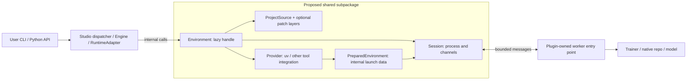

# Shared Isolation Layer: User Flows and Implementation Boundaries

> **Discussion draft.** Public examples reflect the linked POCs; internal examples are proposed pseudocode. `Environment`, `Provider`, and `Session` are not released shared APIs. Code location is identified for each example. No new end-user environment API is required.

## 1. Problem: incompatible dependencies in one application

First-party policies originally required different Transformers versions. Maintaining a common version required porting and testing. Framework/repository integrations add their own Python, Torch, and native-library requirements.

Separate interpreters permit independent dependency sets:

```text
Application interpreter (host)
  ├── child A: policy/framework A + its tested lock
  └── child B: policy/framework B + its tested lock
```

The child owns model/framework imports. The host selects a job or sends observations; it does not import both incompatible stacks. Compatible first-party training and exported-model inference can remain in-process.

Two existing consumers motivate shared infrastructure: [LeRobot PR #10][lerobot] has locked native-training workers; [GR00T PR #23][gr00t] adds Git/patch preparation and persistent inference. Preparation currently lives in `physicalai-train`, which is unsuitable as a deployment prerequisite.

## 2. Existing starting point: the Pixi demonstration

The [Pixi demo][pixi-demo] is an independent object-detection example, not a Physical AI plugin. Its `pixi.toml` defines separate Python/dependency environments; `main.py` invokes tasks and exchanges files:

```text
main.py
  → pixi run preprocess       → preprocessed.jpg
  → pixi run detect-yolo     → detections.json
  → pixi run annotate        → annotated.jpg
```

This demonstrates environment selection. Our inference case additionally needs one child that loads a model once and serves repeated requests. The question is what existing tools can supply and what integration code remains—not whether to write another package manager.

## 3. What users install and call

These examples assume the relevant development branch/dependencies are installed. The isolated first-party dispatcher is proposed; the LeRobot/GR00T examples describe their POCs, not published releases.

### 3.1 First-party CLI and Python API

**User terminal, from Studio's `library/`:**

```bash
physicalai fit --config configs/physicalai/pi05/aloha/default.yaml
physicalai fit --config configs/physicalai/smolvla/pusht/default.yaml
```

The proposed dispatcher chooses the configured policy's environment before importing it. In that interpreter, the existing config parser builds Trainer/model/data objects. Command names, configs, and overrides remain the same. Its location and caller are shown in [Section 4.1](#41-who-calls-dispatch_fit).

**User-owned `train.py`, run in the selected policy interpreter:**

```python
from physicalai.data import LeRobotDataModule
from physicalai.policies import SmolVLA
from physicalai.train import Trainer

model = SmolVLA()
data = LeRobotDataModule(repo_id="lerobot/pusht")
Trainer(max_steps=1000, accelerator="gpu", devices=1).fit(model, datamodule=data)
```

Direct Python calls remain in-process. `fit()` does not move an already constructed model or arbitrary callbacks into another interpreter. Isolation happens when launching the script/job.

### 3.2 LeRobot: official config or native CLI flags

**User Python code:**

```python
from lerobot.configs.default import DatasetConfig
from lerobot.configs.train import TrainPipelineConfig
from lerobot.policies.act.configuration_act import ACTConfig
from physicalai.engine import Engine

config = TrainPipelineConfig(
    dataset=DatasetConfig(repo_id="lerobot/pusht"),
    policy=ACTConfig(device="cuda", push_to_hub=False),
    steps=1000,
)
run = Engine.create("lerobot").train(config)
```

`TrainPipelineConfig` is LeRobot's class. The plugin serializes it and verifies that host/worker LeRobot versions match. CLI users replace the `lerobot-train` prefix with `physicalai train lerobot`; native flags, help, and exit status pass through. No user creates `Environment` objects; that code belongs in the plugin ([Section 4.2](#42-where-does-lerobot-create-and-use-an-environment)).

### 3.3 GR00T: native CLI training, common export/inference API

**User terminal:** the flags belong to upstream `gr00t/experiment/launch_finetune.py`:

```bash
physicalai train gr00t --base-model-path nvidia/GR00T-N1.7-3B \
  --dataset-path /data/libero_demo --embodiment-tag LIBERO_PANDA \
  --output-dir runs/gr00t
```

**User Python code after training:**

```python
from physicalai.engine import Engine
from physicalai.inference import InferenceModel

package = Engine.create("gr00t").export(
    "runs/gr00t", "exports/gr00t-openvino", backend="openvino",
)
with InferenceModel(package) as model:
    actions = model.predict_action_chunk({
        "images": {"image": front_rgb, "wrist_image": wrist_rgb},  # HWC uint8 RGB
        "state": state_vector,  # flat state, per dataset modality mapping
        "task": "put the white mug on the plate",
    })
```

**What is and is not native:**

| Operation            | Contract                                                                                                                                                                                                                       |
| -------------------- | ------------------------------------------------------------------------------------------------------------------------------------------------------------------------------------------------------------------------------ |
| Training CLI         | Same upstream flags and launcher, different command prefix.                                                                                                                                                                    |
| Training Python API  | Current `Gr00tEngine.train()` accepts native argument tokens or a plugin-owned convenience config. NVIDIA's `FinetuneConfig` object is **not yet supported directly**; native-config interoperability is a separate follow-up. |
| Export               | Engine calls the Suite exporter and adds a Runtime package.                                                                                                                                                                    |
| Deployment inference | Common `InferenceModel` API, intentionally not an alias for `Gr00tPolicy.get_action()`. The worker retains GR00T preprocessing/inference/postprocessing.                                                                       |

Native repository APIs remain usable within their own environment. Sharing isolation infrastructure does not expose arbitrary native Python objects in the host. The plugin's implementation is shown in [Section 4.3](#43-where-does-gr00t-select-native-versus-patched-execution). GR00T needs CUDA and Cosmos license access; dataset/camera/state mapping must match the checkpoint.

## 4. Where the implementation belongs

The following paths identify ownership, not a requirement to publish another package. **Runtime** is the `physicalai` repository; **Studio** is `physical-ai-studio`.

| Component                       | Location                                                                | Status / role                                                                                                                                              |
| ------------------------------- | ----------------------------------------------------------------------- | ---------------------------------------------------------------------------------------------------------------------------------------------------------- |
| Shared isolation implementation | Runtime `src/physicalai/isolation/` (working location)                  | Proposed extraction: preparation, source/patch checks, process lifetime, protocol. No Engine/model imports.                                                |
| First-party CLI integration     | Studio `library/src/physicalai/cli/`                                    | Existing public command; new private pre-dispatch helper/worker needed.                                                                                    |
| LeRobot integration             | Studio `plugins/policies/lerobot/src/physicalai_lerobot_policy_plugin/` | Existing Engine/worker; environment declaration would move to a new `environments.py`.                                                                     |
| GR00T integration               | Studio `plugins/policies/gr00t/src/physicalai_gr00t_policy_plugin/`     | Existing `environments.py`, `engine.py`, `package.py`, `runtime.py`, and `_worker/` scripts. Replace duplicated infrastructure, not native model behavior. |

### 4.1 Who calls `dispatch_fit`?

This is **not** a user API or an existing helper. Its proposed call chain is:

```text
Runtime cli/main.py
  → optional selected-command pre_dispatch(raw_argv) hook [new]
    → Studio cli/fit.py: pre_dispatch(argv) [new]
      → Studio cli/_isolation.py: dispatch_fit(argv) [new]
        ├── compatible: return None → existing parser/dispatch
        └── otherwise: launch cli/_fit_worker.py [new] in selected environment
              → existing fit.build_parser() and fit.run()
              → Trainer.fit(...)
```

Runtime must call this hook **before** `_load_spec()` builds the full parser; adding a helper after model imports would be too late. This is new CLI orchestration work, not behavior supplied by `Environment` alone.

**Proposed Studio `library/src/physicalai/cli/fit.py`:**

```python
def pre_dispatch(argv):
    from ._isolation import dispatch_fit
    return dispatch_fit(argv)
```

**Proposed Studio `library/src/physicalai/cli/_isolation.py`:**

```python
def dispatch_fit(argv):
    # Resolve policy selection and overrides without importing model classes.
    policy_id = read_policy_selection(argv)
    env = policy_profiles.get(policy_id)  # package-maintained metadata
    if env is None or verified_current_environment(env):
        return None  # host continues its existing parser/handler
    return env.run(entrypoint=FIT_WORKER, args=argv).exit_code
```

`FIT_WORKER` is the new private `_fit_worker.py`, whose body invokes the existing parser/handler directly, avoiding recursive dispatch. Config composition, overrides, help, and resume behavior must be preserved.

**Packaging prerequisite:** put each policy's requirements in its own extra/lock, not an all-policies base. Shared training/Runtime packages must not force a conflicting Transformers version into every child. Runtime's current mandatory Transformers dependency needs optionalization/separation for workers requiring another version; the shared code still needs testing against each lock.

### 4.2 Where does LeRobot create and use an environment?

Paths below are relative to the **LeRobot integration directory** listed above. These are internal migration sketches, not additional user code.

**`environments.py` — proposed new file; replaces the declaration currently in `engine.py`:**

```python
def training_environment(device):
    return Environment(
        source=BundledProject(plugin_files / "env"),  # existing project + lock
        provider=Uv(lock="uv.lock", extras=worker_extras_for(device)),
    )
```

**`engine.py` — inside the existing `LeRobotEngine.train` method:**

```python
class LeRobotEngine(TrainingEngine):
    def train(self, config):
        verify_host_worker_config_version(config)
        env = training_environment(config.policy.device)
        with temporary_config_directory() as directory:
            config.save_pretrained(directory)
            job = env.run(
                entrypoint=plugin_files / "_worker.py",
                args=[f"--config_path={directory}/train_config.json"],
                on_event=forward_training_progress,
            )
        return to_engine_run(job.payload)
```

Existing `_worker.py` invokes LeRobot's native trainer. Device/profile choice and config serialization stay with this plugin. Its current Runtime adapter is in-process; moving that adapter to a child is only needed for an incompatible dependency set.

### 4.3 Where does GR00T select native versus patched execution?

Paths below are relative to the **GR00T integration directory**. Environment declarations already live in `environments.py`; the migration changes their common infrastructure interface. That module must import only deployment-safe shared code; training-only `Enablement`/Engine registration belongs in `engine.py`.

**`environments.py` — internal declarations:**

```python
NATIVE = Environment(
    source=GitProject(UPSTREAM, revision=PINNED_COMMIT),
    provider=Uv(python="3.10", lock="uv.lock"),
)
OPENVINO = Environment(
    source=GitProject(UPSTREAM, revision=PINNED_COMMIT, patches=OPENVINO_PATCHES),
    provider=Uv(python="3.12", lock="uv.lock"),  # lock in the patched checkout
)
# OPENVINO_PATCHES: PublishedPatches from Suite today; BundledPatches if owned here.
```

**`engine.py` — inside `Gr00tEngine`, called by the user's Engine API:**

```python
class Gr00tEngine(TrainingEngine):
    def train(self, config):
        job = NATIVE.run(
            entrypoint=plugin_files / "_worker/gr00t_train_worker.py",
            args=to_native_cli_tokens(config),
        )
        return to_engine_run(job.payload)

    def export(self, checkpoint, destination, backend="native"):
        if backend == "native":
            return package_native(checkpoint, destination)
        require_backend(backend, "openvino")
        with staging_directory() as ir_directory:
            OPENVINO.run(
                entrypoint=plugin_files / "_worker/gr00t_export_worker.py",
                args=export_arguments(checkpoint, ir_directory),
            )
            return package_openvino(ir_directory, destination)
```

`_worker/` owns calls into upstream GR00T and the Suite exporter. `package.py` writes model data, I/O mapping, environment provenance, and the Runtime manifest. No user calls `NATIVE.run()` or `OPENVINO.run()`.

**`runtime.py` — inside the existing `Gr00tRuntimeAdapter`:**

```python
class Gr00tRuntimeAdapter(RuntimeAdapter):
    def load(self, artifact):
        env = matching_environment(artifact)  # recorded native/OpenVINO identity
        self.session = env.start(entrypoint=inference_worker, request_timeout=10)
        try:
            self.session.request({"op": "load", "artifact": artifact})
        except Exception:
            self.session.close()
            raise

    def predict(self, observation):
        return self.session.request({"op": "predict", "inputs": observation})

    def reset(self):
        self.session.request({"op": "reset"})

    def close(self):
        self.session.close()
```

The plugin's inference entry point registers this adapter. `InferenceModel(package)` reads the manifest and selects it without importing `engine.py`. The child loads once and retains the model; Runtime close releases it, and plugin reset integration forwards episode reset. GR00T's model/processor stay in `_worker/gr00t_infer_worker.py`.

## 5. What is actually shared?



| Object                                              | Existing or proposed?                               | Owns                                                                                                  |
| --------------------------------------------------- | --------------------------------------------------- | ----------------------------------------------------------------------------------------------------- |
| `Engine`/`Trainer`, `RuntimeAdapter`                | Existing in Runtime/Studio POCs                     | Public behavior and model-specific logic; not part of isolation.                                      |
| `ProjectSource`, Git/bundled projects, patch series | Existing in PR #23                                  | Reviewed source materialization and identity/provenance.                                              |
| `WorkerEnv` / `PreparedEnvironment`                 | Existing in POCs                                    | Current declaration and resolved cache paths; migration inputs, not two objects users must construct. |
| `Environment`                                       | Proposed facade                                     | Prepare/reuse and `run`/`start`; construction has no installation side effects.                       |
| `Provider`                                          | Interface proposed; uv integration exists           | Consume a lock and return command, working directory, activation context.                             |
| `Session`                                           | Shared interface proposed; runners exist separately | Child lifetime, generic completion/events, framed messages, deadlines, logs, cleanup.                 |

The shared layer does not know training checkpoints or observation semantics. A completion supplies an `exit_code` and plugin-defined `payload`; the consumer translates these into its own result. Other packages can supply their own workers. Multiple training/export/inference processes can reuse one prepared dependency environment.

## 6. Tool choices and justification

| Option                      | Supplies                                              | Still to evaluate/integrate                                                                        |
| --------------------------- | ----------------------------------------------------- | -------------------------------------------------------------------------------------------------- |
| [uv][uv]                    | Python and locked project installation; POC baseline  | Persistent lifecycle/IPC; lock freshness and source/patch policy.                                  |
| [Pixi][pixi]                | Conda/PyPI environments, activation, tasks            | Persistent process reuse; an explicitly maintained Pixi lock, not automatic `uv.lock` equivalence. |
| [Isolate][isolate]          | Candidate environment and execution library           | Existing locks, resident model state, serialization, cleanup, source/license, maintenance.         |
| [execnet][execnet]          | Interpreter gateways and channels                     | Separate installation, numeric buffers, bounded failure.                                           |
| [Ray][ray] / OCI containers | Distributed actors or image-based native dependencies | Operational/device/deployment cost appropriate to the application.                                 |

**A shared contract does not imply a custom manager.** Delegate environment/process work an existing tool already handles. Residual code selects plugin-owned inputs, checks artifact/environment compatibility, and translates to the consumer's API. If a library satisfies the full contract directly, a separate wrapper may be unnecessary.

Before adoption, compare tools using the same persistent worker—not the Pixi demo's one-task/model-load pattern. Validate clean inference installs without `physicalai-train`, first-party conflicting dependency jobs, LeRobot regressions, GR00T/Cosmos parity/reset/close, bounded failures, offline assets, immutable packages, and safe cache cleanup. Isolation is not a sandbox and must not silently retry stateful requests or execute artifact-selected commands.

The shared implementation can initially ship in Runtime and later with a lightweight InferenceKit base or independent monorepo library ([packaging context][packaging]). Every inference plugin must work without training; this does not mean every plugin needs a child process or that moving source code removes Runtime's existing dependency footprint.

**Feedback requested:** Are the public/internal boundaries correct? Can an existing library remove more code? Which consumer/platform requirements are missing?

[gr00t]: https://github.com/samet-akcay/physical-ai-studio/pull/23
[lerobot]: https://github.com/samet-akcay/physical-ai-studio/pull/10
[pixi-demo]: https://github.com/leoll2/pixi-demo
[uv]: https://docs.astral.sh/uv/concepts/projects/sync/
[pixi]: https://pixi.sh/latest/tutorials/multi_environment/
[isolate]: https://pypi.org/project/isolate/
[execnet]: https://execnet.readthedocs.io/
[ray]: https://docs.ray.io/en/latest/ray-core/handling-dependencies.html
[packaging]: https://github.com/openvinotoolkit/physicalai/blob/docs/design/docs/design/packaging/modular-packages-in-one-repo.md
