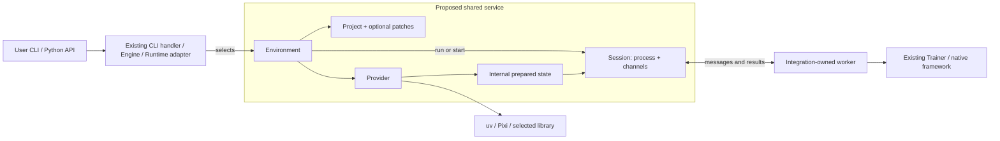

# Dependency Isolation: From Public API to Native Process

> **Discussion draft.** Public examples describe the linked POCs. Shared infrastructure and automatic first-party dispatch are proposed, not implemented APIs. `physicalai.isolation` is a working package name.

## 1. Problem: incompatible dependencies in one application

First-party policies originally required different Transformers versions. Maintaining a common version required porting and testing. Framework/repository integrations add their own Python, Torch, and native-library requirements.

Separate interpreters permit independent dependency sets:

```text
Application interpreter (host)
  ├── child A: policy/framework A + its tested dependencies
  └── child B: policy/framework B + its tested dependencies
```

The child imports and runs its framework. The host launches a job or sends observations without importing both incompatible stacks. Compatible training and inference can still run in-process.

This infrastructure is already appearing in two integrations: [LeRobot PR #10][lerobot] has locked native-training workers; [GR00T PR #23][gr00t] adds Git/patch preparation and persistent inference. Sharing it would avoid repeated implementations and remove deployment's dependence on `physicalai-train`.

## 2. Existing starting point: the Pixi demonstration

The [Pixi demo][pixi-demo] is an independent object-detection example, not a Physical AI plugin. Its `pixi.toml` defines separate environments; `main.py` invokes tasks and exchanges files:

```text
main.py
  → preprocess environment → preprocessed.jpg
  → detector environment   → detections.json
  → annotation environment → annotated.jpg
```

It demonstrates selecting incompatible environments from one application. For model inference, we additionally need a child that loads once and serves repeated requests. This motivates evaluating existing tools before deciding which integration code to share.

## 3. What users install and call

The intended installation split is training plus a selected plugin, or deployment with only that plugin's Runtime/shared dependencies:

```bash
uv pip install "physicalai-train[gr00t]"  # training/export host
uv pip install physicalai-gr00t-policy-plugin  # deployment host, no training
```

These describe the target package contract, not published releases or a claim that train-free provisioning is already implemented. The examples below assume the development branch/dependencies are installed. Users call training/inference APIs, not environment objects.

### 3.1 First-party CLI and Python API

**User terminal, from Studio's `library/`:**

```bash
physicalai fit --config configs/physicalai/pi05/aloha/default.yaml
physicalai fit --config configs/physicalai/smolvla/pusht/default.yaml
```

The proposal retains these commands, configs, and overrides. A launcher selects the configured policy's environment before importing it, then runs normal first-party training there. [Section 4.1](#41-selecting-before-framework-imports) explains the proposed integration point.

**User-owned `train.py`, executed in the selected policy interpreter:**

```python
from physicalai.data import LeRobotDataModule
from physicalai.policies import SmolVLA
from physicalai.train import Trainer

model = SmolVLA()
data = LeRobotDataModule(repo_id="lerobot/pusht")
Trainer(max_steps=1000, accelerator="gpu", devices=1).fit(model, datamodule=data)
```

Direct Python calls remain in-process. `fit()` does not migrate an already constructed model or arbitrary callbacks. Select the interpreter when launching the script/job, not after creating its objects.

### 3.2 LeRobot: official config or native CLI flags

**User Python code:**

```python
from lerobot.configs.default import DatasetConfig
from lerobot.configs.train import TrainPipelineConfig
from lerobot.policies.act.configuration_act import ACTConfig
from physicalai.engine import Engine

config = TrainPipelineConfig(
    dataset=DatasetConfig(repo_id="lerobot/pusht"),
    policy=ACTConfig(device="cuda", push_to_hub=False),
    steps=1000,
)
run = Engine.create("lerobot").train(config)
```

`TrainPipelineConfig` is LeRobot's class. The plugin serializes it and verifies matching host/worker versions. CLI users replace `lerobot-train` with `physicalai train lerobot`; native flags, help, and exit status pass through. The plugin, not the user, selects the environment.

### 3.3 GR00T: native CLI training, common export/inference API

**User terminal:** the flags belong to upstream `gr00t/experiment/launch_finetune.py`:

```bash
physicalai train gr00t --base-model-path nvidia/GR00T-N1.7-3B \
  --dataset-path /data/libero_demo --embodiment-tag LIBERO_PANDA \
  --output-dir runs/gr00t
```

**On the training/export host:**

```python
from physicalai.engine import Engine

package = Engine.create("gr00t").export(
    "runs/gr00t", "exports/gr00t-openvino", backend="openvino",
)
```

**After delivering the exported package to the deployment host:**

```python
from physicalai.inference import InferenceModel  # no Engine/training import

with InferenceModel("exports/gr00t-openvino") as model:
    actions = model.predict_action_chunk({
        "images": {"image": front_rgb, "wrist_image": wrist_rgb},  # HWC uint8 RGB
        "state": state_vector,  # per dataset modality mapping
        "task": "put the white mug on the plate",
    })
```

| Operation            | What the integration preserves or adds                                                                                                                                              |
| -------------------- | ----------------------------------------------------------------------------------------------------------------------------------------------------------------------------------- |
| Training CLI         | Upstream flags and launcher; only the command prefix changes.                                                                                                                       |
| Training Python API  | Current Engine accepts native argument tokens or a plugin-owned convenience config. Direct NVIDIA `FinetuneConfig` input remains a follow-up, not a capability of isolation itself. |
| Export               | Engine invokes the Suite exporter and packages its output for Runtime.                                                                                                              |
| Deployment inference | Common `InferenceModel` interface; GR00T's preprocessing/model/postprocessing remain native inside the child. This is not an alias for `Gr00tPolicy.get_action()`.                  |

Native repository APIs remain available in their own environment. GR00T requires CUDA and Cosmos license access; data/observation mapping must match the checkpoint.

## 4. Proposed solution: one shared launch and lifecycle service

The three user flows follow the same internal sequence:

```text
User CLI/API
  → existing CLI handler, Engine, or Runtime adapter selects an environment
  → shared service prepares/reuses its source and locked dependencies
  → shared service launches the integration's own worker
  → worker calls existing Trainer or native framework code
  → result returns to the existing API; process is closed when finished
```

The proposed shared service uses these objects:

| Object                         | Meaning                                                                         | Status                                                                           |
| ------------------------------ | ------------------------------------------------------------------------------- | -------------------------------------------------------------------------------- |
| `Environment`                  | Lazy handle to reviewed source, dependency configuration, and launch operations | Proposed facade over existing `WorkerEnv` declarations and preparation functions |
| Project and patch declarations | Where code comes from and how it is verified                                    | Git/bundled projects and published/bundled patches exist in PR #23               |
| `Provider`                     | Adapter to uv or another environment/execution tool                             | uv calls exist; common provider interface is proposed                            |
| `Session`                      | One owned child process and its communication channels                          | Common interface proposed over Engine's job runner and GR00T's persistent worker |
| `PreparedEnvironment`          | Internal resolved launch/cache information                                      | Exists in POCs; not another object users must construct                          |



`run(...)` waits for a finite job; `start(...)` retains a process for repeated requests. One prepared environment can support several sessions. The provider supplies launch/activation information; the session manages the process. Neither defines policy configuration, checkpoints, or observation semantics.

The following subsections trace that sequence. All code in them is **proposed internal pseudocode**, not application code or a finalized interface.

### 4.1 Selecting before framework imports

For first-party training, the existing CLI must select an environment before its full parser imports policy classes. The proposed integration is an optional early hook for the selected command:

```text
Runtime src/physicalai/cli/main.py
  → calls selected command's optional pre_dispatch(raw_arguments) [new hook]
    → Studio library/src/physicalai/cli/fit.py supplies that hook [new function]
      ├── already compatible: continue existing parsing/dispatch
      └── otherwise: run Studio's private fit worker in the chosen environment
```

**Proposed addition to Studio `library/src/physicalai/cli/fit.py`:**

```python
def pre_dispatch(argv):
    # New config-only selection step: honor composition/overrides, import no model.
    policy_id = read_policy_selection(argv)
    env = policy_profiles.get(policy_id)  # metadata maintained with the policy
    if env is None or verified_current_environment(env):
        return None  # Runtime CLI continues its current parser/handler
    return env.run(entrypoint=FIT_WORKER, args=argv).exit_code
```

Runtime would invoke the hook before `_load_spec()` builds the full parser. Returning `None` means local execution; an integer is the delegated command's exit code. The hook and config-only selection are new work, not current CLI behavior.

`FIT_WORKER` would be Studio's new private `library/src/physicalai/cli/_fit_worker.py`. Its training body uses the **existing** handler:

```python
def main(argv):
    from physicalai.cli.fit import build_parser, run
    parser = build_parser()  # policy dependencies are available in this interpreter
    return run(parser, parser.parse_args(argv))  # existing Trainer.fit dispatch
```

The worker bypasses the outer routing hook, so there is no relaunch loop. Compatible direct calls are unchanged. Config composition, overrides, help, resume, and callbacks remain requirements of the original CLI.

**Prerequisite:** each selected policy needs its own installable dependency profile/lock. Shared training/Runtime packages cannot impose a conflicting Transformers version in every child. Isolation does not eliminate testing shared code against those versions.

### 4.2 Preparing the selected environment

The shared service consumes the environment declaration; it does not decide which policy needs one. Declarations belong to the integrating package:

| Integration        | Declaration location                                                                                                                         |
| ------------------ | -------------------------------------------------------------------------------------------------------------------------------------------- |
| First-party policy | Studio's policy metadata/dependency profiles, referenced by the new CLI hook                                                                 |
| LeRobot            | Proposed `plugins/policies/lerobot/src/physicalai_lerobot_policy_plugin/environments.py`; moves the declaration currently in its `engine.py` |
| GR00T              | Existing `plugins/policies/gr00t/src/physicalai_gr00t_policy_plugin/environments.py`                                                         |

**LeRobot's proposed `environments.py`:**

```python
def training_environment(device):
    return Environment(
        source=BundledProject(plugin_files / "env"),  # existing project + lock
        provider=Uv(lock="uv.lock", extras=worker_extras_for(device)),
    )
```

**GR00T's existing `environments.py`, expressed with the proposed interface:**

```python
NATIVE = Environment(
    source=GitProject(UPSTREAM, revision=PINNED_COMMIT),
    provider=Uv(python="3.10", lock="uv.lock"),
)
OPENVINO = Environment(
    source=GitProject(UPSTREAM, revision=PINNED_COMMIT, patches=OPENVINO_PATCHES),
    provider=Uv(python="3.12", lock="uv.lock"),  # lock from the patched project
)
```

`plugin_files` denotes the installed integration's resource directory, not a user's checkout. The declared worker scripts and lock resources ship with that integration.

When `run` or `start` needs an environment, the shared service performs:

```text
Verify source/patch inputs → materialize pinned project → consume its lock via provider
                          → record content identity → reuse compatible cached environment
```

`OPENVINO_PATCHES` is the Suite's pinned published series today. A team contributing locally can use bundled patch files; layers support both. Source identity and patch origin are recorded separately so moving identical reviewed patches need not invalidate compatible packages.

### 4.3 Running the native job and packaging its result

The Engine owns the public method from Section 3. It calls the shared service with its own worker, then converts generic completion data into its existing result type.

**LeRobot package `engine.py`, inside `LeRobotEngine`:**

```python
class LeRobotEngine(TrainingEngine):
    def train(self, config):
        verify_host_worker_config_version(config)
        env = training_environment(config.policy.device)
        with temporary_config_directory() as directory:
            config.save_pretrained(directory)
            job = env.run(
                entrypoint=plugin_files / "_worker.py",
                args=[f"--config_path={directory}/train_config.json"],
                on_event=forward_training_progress,
            )
        return to_engine_run(job.payload)
```

Its existing `_worker.py` calls LeRobot's native trainer. The shared service does not understand `TrainPipelineConfig`, device settings, or optimizer steps.

**GR00T package `engine.py`, inside `Gr00tEngine`:**

```python
class Gr00tEngine(TrainingEngine):
    def train(self, config):
        job = NATIVE.run(
            entrypoint=plugin_files / "_worker/gr00t_train_worker.py",
            args=to_native_cli_tokens(config),
        )
        return to_engine_run(job.payload)

    def export(self, checkpoint, destination, backend="native"):
        if backend == "native":
            return package_native(checkpoint, destination)
        require_backend(backend, "openvino")
        with staging_directory() as ir_directory:
            OPENVINO.run(
                entrypoint=plugin_files / "_worker/gr00t_export_worker.py",
                args=export_arguments(checkpoint, ir_directory),
            )
            return package_openvino(ir_directory, destination)
```

Thus the user's `engine.export(..., backend="openvino")` selects the patched environment **inside the Engine**. GR00T's `_worker/` scripts call upstream code and the Suite exporter; its `package.py` writes model data, I/O mapping, source/environment provenance, and a Runtime manifest. Users do not call `NATIVE.run()` or `OPENVINO.run()`.

### 4.4 Keeping inference alive between requests

The package manifest selects the installed plugin's inference adapter. The adapter selects the recorded environment and starts its inference worker once:

```text
User: InferenceModel(exported_package)
  → Runtime loads manifest and resolves installed adapter
  → GR00T runtime.py: Gr00tRuntimeAdapter.load()
  → selected Environment starts _worker/gr00t_infer_worker.py
  → worker loads native processors/model once
  → repeated predictions and episode resets
  → InferenceModel.close() closes the adapter's session
```

**GR00T package `runtime.py`, inside its existing adapter:**

```python
class Gr00tRuntimeAdapter(RuntimeAdapter):
    def load(self, artifact):
        env = matching_environment(artifact)
        self.session = env.start(entrypoint=inference_worker, request_timeout=10)
        try:
            self.session.request({"op": "load", "artifact": artifact})
        except Exception:
            self.session.close()
            raise

    def predict(self, observation):
        return self.session.request({"op": "predict", "inputs": observation})

    def reset(self):
        self.session.request({"op": "reset"})

    def close(self):
        self.session.close()
```

The shared session owns framing, deadlines, logs, process failure, and cleanup. The adapter/worker own model operations and data mapping. Environment declarations used by inference must not import Engine or training-only registration.

Every plugin advertising inference must work without `physicalai-train` in the host or inference child. LeRobot's current Runtime adapter is in-process and need not change unless its selected dependencies conflict. A converter or evaluation package can reuse the same session mechanism with different messages.

## 5. Existing tools and the remaining shared code

| Option                      | Existing capability                                  | Integration question                                                                              |
| --------------------------- | ---------------------------------------------------- | ------------------------------------------------------------------------------------------------- |
| [uv][uv]                    | Python and locked project installation; POC baseline | How much lifecycle/communication support must remain elsewhere?                                   |
| [Pixi][pixi]                | Conda/PyPI environments, activation, tasks           | Can the same resident worker run with an explicitly maintained Pixi lock?                         |
| [Isolate][isolate]          | Environment/execution library candidate              | Can it cover locks, persistent model state, safe serialization, and cleanup with less owned code? |
| [execnet][execnet]          | Interpreter gateways and channels                    | Can it reduce process/communication code when paired with a provisioner?                          |
| [Ray][ray] / OCI containers | Distributed actors or image-based dependencies       | Are their operational/device costs justified for the intended deployment?                         |

The Pixi example in Section 2 is one candidate starting point, not a selected implementation. Evaluate alternatives using the same worker, model, observations, and persistent lifetime. A different lock requires compatibility validation, not an assumption of equivalence.

**The requirement is shared behavior, not ownership of a custom manager.** Reuse tools for installation and process management wherever possible. Residual integration selects reviewed plugin inputs, associates artifacts with environments, and translates native results/messages into existing APIs. If a library satisfies the complete contract, a separate wrapper may be unnecessary.

## 6. Implementation boundaries and adoption checks

- Shared code must not import Engine, policy/model classes, or robot scheduling. Dependency/process isolation is not a security sandbox.
- Training/export can be finite jobs; inference should retain the loaded model. Use bounded non-pickle messages, explicit errors, deterministic shutdown, and no automatic retries of stateful requests.
- Preparation/cache operations must verify source/lock/profile identity, survive interruption/concurrency, protect active sessions, and leave model packages unchanged. Offline operation also requires cached model assets.
- Validate first-party jobs with conflicting locks after packaging changes, LeRobot config/CLI/progress/cancellation, and GR00T/Cosmos train/export/inference parity/reset/close. Test clean deployment installs without training.
- The shared implementation can initially ship in Runtime, later with a lightweight InferenceKit base or independent monorepo library ([packaging context][packaging]). A source move alone does not remove the parent package's installation footprint.

**Review questions:** Does the proposed routing preserve the public APIs? Which tool removes the most repeated code? What additional consumer/platform constraints must be tested?

[gr00t]: https://github.com/samet-akcay/physical-ai-studio/pull/23
[lerobot]: https://github.com/samet-akcay/physical-ai-studio/pull/10
[pixi-demo]: https://github.com/leoll2/pixi-demo
[uv]: https://docs.astral.sh/uv/concepts/projects/sync/
[pixi]: https://pixi.sh/latest/tutorials/multi_environment/
[isolate]: https://pypi.org/project/isolate/
[execnet]: https://execnet.readthedocs.io/
[ray]: https://docs.ray.io/en/latest/ray-core/handling-dependencies.html
[packaging]: https://github.com/openvinotoolkit/physicalai/blob/docs/design/docs/design/packaging/modular-packages-in-one-repo.md
