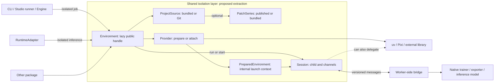
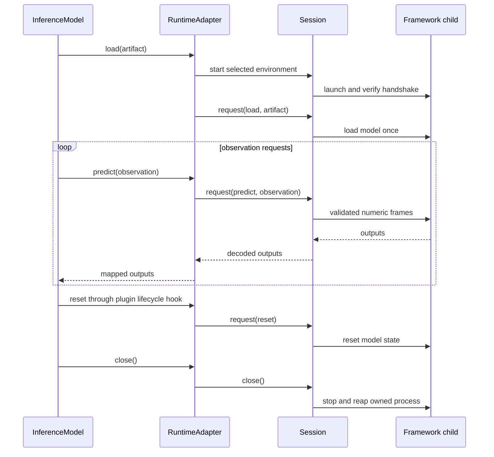

# Shared Isolation Layer: Objects and Integration Flows

> **Discussion draft.** Infrastructure code below is pseudocode, not a released API. Public CLI/Trainer examples use existing interfaces. `physicalai.isolation` is a working name; tool and distribution choices remain open.

## 1. Problem and requirements

| Consumer                  | Need                                                                                                                                             |
| ------------------------- | ------------------------------------------------------------------------------------------------------------------------------------------------ |
| First-party policies      | Retain separately tested Transformers/Torch versions instead of adapting every policy to one dependency set. Compatible calls remain in-process. |
| [LeRobot plugin][lerobot] | Reuse its existing locked native-training environment, config serialization, progress, and cancellation. No source patches are required.         |
| [GR00T plugin][gr00t]     | Prepare upstream and patched OpenVINO environments; retain a loaded model in an isolated inference process.                                      |

The proposal shares existing infrastructure rather than implementing another solver or training API. Every plugin advertising inference must deploy without `physicalai-train` in the host or inference child.

```text
Required: reviewed source + authoritative lock + managed process + bounded messages
Not required: one environment per policy, a new public training API, or a custom package manager
```

Dependency/process isolation is not a security sandbox. Framework code retains the operator's privileges.

## 2. Object architecture

Arrows indicate use, not imports into the shared layer. In-process consumers bypass this layer.



### Existing objects and proposed changes

“Existing” means available in Runtime or the linked Studio POCs, not necessarily merged or generally validated.

| Object                                          | Status                             | Responsibility / change                                                                                                          |
| ----------------------------------------------- | ---------------------------------- | -------------------------------------------------------------------------------------------------------------------------------- |
| `Engine`, `TrainingEngine`, `Trainer`           | Studio / POCs                      | Own training APIs, policy selection, hooks, and results. Remain outside the shared layer.                                        |
| `InferenceModel`, `RuntimeAdapter`              | Runtime                            | Own inference API, artifact loading, model operations, and close lifecycle. Remain outside.                                      |
| `ProjectSource`, `BundledProject`, `GitProject` | Studio PR #23                      | Materialize reviewed source. Reuse in shared code.                                                                               |
| `PublishedPatches`, `BundledPatches`            | Studio PR #23                      | Apply ordered patch layers; verify digests/resulting tree and record provenance.                                                 |
| `WorkerEnv`                                     | Studio POCs                        | Current environment declaration. Source/dependency settings move behind the shared interface.                                    |
| `PreparedEnvironment`                           | Studio POCs                        | Resolved paths/cache identity. Keep internal; extend launch data for provider activation if needed.                              |
| `Environment`                                   | Proposed facade                    | Prepare, run a finite job, or start a persistent session. No I/O during construction.                                            |
| `Provider` / `Uv`                               | Interface proposed; uv calls exist | Delegate installation/activation to the selected tool; support validated existing interpreters.                                  |
| `Session` and bridge                            | Common interface proposed          | Consolidate Engine supervision and GR00T's `_Worker`/numeric protocol. Own channels, deadlines, and cleanup—not model semantics. |

### Environment and process are different objects

```text
One environment / tested lock
    ├── Session 1: finite training job → exit
    ├── Session 2: finite export job   → exit
    └── Session 3: persistent model   → predict, predict, reset, close

Environment lifetime: cached and reusable
Session lifetime: one owned child process
```

```python
# Pseudocode: callers need not manage a second prepared-state object.
class Environment:
    def __init__(self, source, provider, profile=None):
        self.source, self.provider, self.profile = source, provider, profile

    def prepare(self, offline=False):
        self._prepared = cache.prepare_or_reuse(
            source=self.source, provider=self.provider,
            profile=self.profile, offline=offline,
        )  # validates inputs; stages source; consumes the lock; records identity
        return self

    def start(self, entrypoint, args=(), **deadlines):
        self.prepare()
        return Session.launch(self._prepared, entrypoint, args, **deadlines)

    def run(self, entrypoint, args=(), on_event=None):
        with self.start(entrypoint, args) as session:
            return session.wait(on_event=on_event)  # generic completion/events
```

Providers return executable/command, working directory, and activation context—not necessarily just a Python path. Model assets have separate revisions. Warm reuse must not resynchronize dependencies per prediction; source/lock/profile/provider/platform changes require identity validation.

## 3. Integration flows

### 3.1 First-party CLI and Python API

Users keep existing commands and configs:

```bash
physicalai fit --config configs/physicalai/pi05/aloha/default.yaml
physicalai fit --config configs/physicalai/smolvla/pusht/default.yaml
```

**Proposed internal dispatch, not implemented today:**

```python
# CLI/Studio internals: before importing a policy or building live objects.
def dispatch_fit(argv):
    config = read_training_recipe(argv)
    environment = policy_metadata.environment_for(config.model.class_path)
    if environment is None or verified_current_environment(environment):
        return existing_fit_handler(argv)
    completion = environment.run(entrypoint=fit_worker, args=argv)
    return completion.exit_code

# fit_worker uses the existing handler in the selected environment; no redispatch loop.
```

The Python API runs unchanged in the selected interpreter:

```python
# train.py: ordinary first-party API, e.g. in the SmolVLA environment.
from physicalai.data import LeRobotDataModule
from physicalai.policies import SmolVLA
from physicalai.train import Trainer

model = SmolVLA()
data = LeRobotDataModule(repo_id="lerobot/pusht")
Trainer(max_steps=1000, accelerator="gpu", devices=1).fit(model, datamodule=data)
```

Launch the script/job before constructing its objects; `fit()` does not migrate a live model, datamodule, or callbacks between interpreters. Different dependency sets also require packaging changes: policy-specific requirements cannot remain globally imposed by shared base packages. This includes Runtime's mandatory Transformers dependency when a child needs another version. Do not install an all-policies extra in every child.

### 3.2 LeRobot: bundled project, native config

```python
# User: existing Engine API and official LeRobot TrainPipelineConfig.
engine = Engine.create("lerobot")
run = engine.train(config)
```

```python
# Plugin internals: proposed common facade over PR #10's existing flow.
environment = Environment(
    source=BundledProject(plugin_files / "env"),  # pyproject.toml + uv.lock
    provider=Uv(lock="uv.lock", extras=worker_extras_for(config.policy.device)),
)
config.save_pretrained(config_dir)
completion = environment.run(
    entrypoint=lerobot_worker,
    args=[f"--config_path={config_dir}/train_config.json"],
    on_event=forward_training_progress,
)
run = translate_to_engine_run(completion)
```

Native config-version checks and device selection remain LeRobot integration responsibilities. The current LeRobot Runtime adapter is in-process; persistent inference is needed only for an incompatible dependency set.

### 3.3 GR00T: repository and patch enablement

```python
# Plugin-owned declarations; names/signatures are illustrative.
native = Environment(
    source=GitProject(UPSTREAM_REPOSITORY, revision=PINNED_COMMIT),
    provider=Uv(python="3.10", lock="uv.lock"),
)
openvino = Environment(
    source=GitProject(
        UPSTREAM_REPOSITORY, revision=PINNED_COMMIT,
        patches=BundledPatches(plugin_files / "patches/openvino", tree=REVIEWED_TREE),
    ),
    provider=Uv(python="3.12", lock="uv.lock"),  # lock in the patched source
)
openvino_enablement = Enablement(
    name="openvino", env=openvino,
    provides={"gr00t_n1d7": {"export": ("openvino",)}},
)
```

```python
# Inside the GR00T Engine; native configs and artifact packaging stay here.
completion = native.run(entrypoint=train_worker, args=native_training_args)
exported = openvino.run(entrypoint=export_worker, args=[checkpoint, destination])
package = package_for_runtime(exported, provenance=record_environment(openvino))
```

`PublishedPatches(repository=..., revision=..., files=..., tree=...)` can reference another team's series. Layers support published base patches plus local fixes. Source identity and provenance remain distinct: moving identical reviewed patches locally need not invalidate compatible environments/packages.

### 3.4 Persistent inference and data flow



```python
# Inference adapter internals: no training imports.
class Adapter:
    def load(self, artifact):
        self.session = environment_for(artifact).start(
            entrypoint=inference_worker, startup_timeout=60, request_timeout=10,
        )
        try:
            self.session.request({"op": "load", "artifact": artifact})
        except Exception:
            self.session.close()
            raise

    def predict(self, observation):
        return self.session.request({"op": "predict", "inputs": observation})

    def reset(self):
        self.session.request({"op": "reset"})

    def close(self):
        self.session.close()
```

The session provides bounded framing, compatible-protocol checks, logs, errors, and shutdown. The plugin defines observation/output schemas and model state. JSON plus numeric buffers excludes pickle/object-array transport. Never automatically retry a stateful prediction. A converter or evaluation package can use the same process contract without importing Engine or `InferenceModel`.

### 3.5 Installation boundary

```bash
# Target published installation contract; extras select plugins.
uv pip install "physicalai-train[gr00t]"  # training host
uv pip install physicalai-gr00t-policy-plugin  # deployment host, no physicalai-train
```

Every inference plugin must meet this separation in both host and child. Plugins own their integration code, locks, workers, patches/references, and declared upstream dependencies; “self-contained” does not require bundling drivers or licensed model assets into a wheel. Shared preparation must therefore be available outside `physicalai-train`.

## 4. Existing tools and remaining responsibilities

| Option             | Can replace                                                       | Validate before adoption                                                              |
| ------------------ | ----------------------------------------------------------------- | ------------------------------------------------------------------------------------- |
| [uv][uv]           | Python installation and locked environment sync; current baseline | Lock/metadata agreement; lifecycle/IPC remain outside uv.                             |
| [Pixi][pixi]       | Conda/PyPI environments, activation, tasks                        | Own Pixi lock; persistent worker and CUDA/OpenVINO behavior.                          |
| [Isolate][isolate] | Candidate for environment and execution management                | Existing locks, resident models, serialization, cleanup, source/license, maintenance. |
| [execnet][execnet] | Persistent interpreter gateways and channels                      | Separate environment installation; numeric buffers and bounded failure.               |
| [Ray][ray]         | Actors, environments, distributed placement                       | Operational footprint justified by actual distributed requirements.                   |
| OCI containers     | Native dependencies and prebuilt image delivery                   | Image distribution, device access, startup, lifecycle.                                |

The [Pixi demo][pixi-demo] proves multi-environment task selection/file handoff, not persistent inference performance. Compare tools on the same workers and inputs. Alternatives are not validated GR00T backends merely by appearing in this table.

**We need shared integration contracts, not necessarily our own manager.**

```python
# Same plugin behavior; provider-specific project/lock explicitly selected.
env = Environment(source=project, provider=Uv(lock="uv.lock"))
env = Environment(source=project, provider=Pixi(lock="pixi.lock", name="model"))

# If an existing library already satisfies the complete contract:
env = ExistingLibraryIntegration(reviewed_configuration)
```

Residual integration: plugin-owned source/patch/profile selection, artifact/environment compatibility, and translation to Engine or inference messages. Delegate anything else an external library supplies. Do not automatically translate locks, silently switch providers, or retain a custom implementation solely to preserve the prototype.

## 5. Adoption criteria and open decisions

```text
Evaluate tools → extract common remainder → migrate LeRobot + GR00T
              → validate separately versioned first-party jobs
              → decide distribution ownership when needed
```

| Gate                 | Required evidence                                                                                                          |
| -------------------- | -------------------------------------------------------------------------------------------------------------------------- |
| First-party behavior | Same public CLI/Trainer contract; two jobs with genuinely conflicting locks after dependency-packaging changes.            |
| Existing plugins     | LeRobot native config/CLI/progress/cancellation; GR00T/Cosmos train/export/infer, parity, and reset/replay.                |
| Deployment           | Clean plugin wheel install, no training package in host/child, read-only artifacts, offline dependencies and model assets. |
| Lifecycle            | Startup/crash/request-timeout/cancellation/cleanup-failure tests; no leaked owned children or channels.                    |
| Reproducibility      | Source/patch/lock verification, concurrent/interrupted preparation, active-session-safe cache cleanup.                     |
| Tool comparison      | Cold provisioning, warm load, steady-state latency, memory, and maintenance footprint measured separately.                 |

The layer can initially ship as a Runtime subpackage, later with a lightweight InferenceKit base or an independent monorepo library ([packaging context][packaging]). It must not import training, inference-model, or robot APIs. Moving source code alone does not remove the parent distribution's installation footprint.

For feedback: **Which objects are necessary after selecting an existing tool? Which consumer/platform constraints are missing? Is separate installation needed now?**

[gr00t]: https://github.com/samet-akcay/physical-ai-studio/pull/23
[lerobot]: https://github.com/samet-akcay/physical-ai-studio/pull/10
[uv]: https://docs.astral.sh/uv/concepts/projects/sync/
[pixi]: https://pixi.sh/latest/tutorials/multi_environment/
[pixi-demo]: https://github.com/leoll2/pixi-demo
[isolate]: https://pypi.org/project/isolate/
[execnet]: https://execnet.readthedocs.io/
[ray]: https://docs.ray.io/en/latest/ray-core/handling-dependencies.html
[packaging]: https://github.com/openvinotoolkit/physicalai/blob/docs/design/docs/design/packaging/modular-packages-in-one-repo.md
