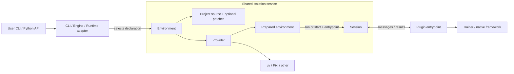

# Shared Dependency Isolation

> **Discussion draft.** This document describes a proposed shared service for preparing and launching isolated Python environments. Public training and inference APIs stay as they are today; users do not construct isolation objects. Some pieces already exist in integration POCs ([LeRobot][lerobot], [GR00T][gr00t]); the shared package and first-party CLI dispatch are proposed. The Runtime package name is `physicalai.isolate` (implemented in this repository; previously discussed as `physicalai.isolation`).

## 1. Problem

Physical AI hosts (Studio training, Runtime deployment) often need frameworks whose dependencies cannot share one Python interpreter. First-party policies have required different Transformers versions. Repository integrations bring their own Python, Torch, and native-library pins.

The host process therefore needs a way to:

1. Select a reviewed, locked dependency set for one policy or framework.
2. Prepare that set once and reuse it (content-keyed cache).
3. Run a **finite job** (train, export) or keep a **long-lived process** (inference) that imports the framework only inside that set.
4. Return results through existing Engine / Runtime APIs without teaching those APIs about uv, Git, or patches.

```text
Host interpreter (application)
  ├── child A: framework A + its tested dependencies
  └── child B: framework B + its tested dependencies
```

Compatible work can still run in-process. Isolation is for incompatible stacks, not for every call.

Today each integration reimplements preparation and process lifecycle. Sharing that avoids duplication and lets a deployment host use a plugin without installing `physicalai-train`.

## 2. Vocabulary

These terms are used consistently below. They are **not** interchangeable.

| Term | Meaning |
| --- | --- |
| **Host** | The application interpreter that selects work and talks to users (CLI, Engine, `InferenceModel`). |
| **Environment (declaration)** | Immutable description of *what* to prepare: project source, Python/sync profile, and identity for caching. It does **not** include which script to run. |
| **Prepared environment** | Cached result of preparation: materialized project tree + synchronized interpreter. |
| **Provider** | Tool adapter that installs/activates dependencies (uv today; Pixi or another tool is evaluable). |
| **Session** | One owned child process and its communication channels. Created at launch time. |
| **Entrypoint** | Plugin-owned worker script chosen when launching (`run` / `start`), not stored on the environment declaration. |
| **Project source** | Where the uv (or equivalent) project tree comes from. |
| **Bundled** | Files **shipped inside the plugin package** (wheel / package resources), reviewed and versioned with that plugin. Does **not** mean “we implemented the upstream framework.” |
| **Published patches** | Patch files still owned in another repository; fetched or mirrored at a pinned revision and verified by digest (and usually a resulting Git tree). |
| **Enablement** | A **validated capability** for a policy (first-party or plugin)—for example, “this policy can be exported to OpenVINO.” It is product/capability metadata. It may *point at* an environment when the capability needs different code or dependencies. It is **not** a source type and not a synonym for “bundled.” |

## 3. What users install and call

Users install a training host plus a plugin, or a deployment host with only the plugin’s Runtime dependencies:

```bash
uv pip install "physicalai-train[gr00t]"           # training/export host
uv pip install physicalai-gr00t-policy-plugin      # deployment host, no training stack
```

They call existing CLIs and Python APIs. They do **not** construct `Environment`, providers, or sessions.

### 3.1 First-party training

```bash
physicalai fit --config configs/physicalai/pi05/aloha/default.yaml
physicalai fit --config configs/physicalai/smolvla/pusht/default.yaml
```

Direct Python training remains in-process in the interpreter the user already launched:

```python
from physicalai.data import LeRobotDataModule
from physicalai.policies import SmolVLA
from physicalai.train import Trainer

Trainer(max_steps=1000, accelerator="gpu", devices=1).fit(SmolVLA(), LeRobotDataModule(...))
```

`fit()` does not migrate an already constructed model into another environment. Isolation, when needed, happens by selecting an interpreter **before** importing the conflicting stack (see [§6.1](#61-first-party-cli-select-before-imports)).

### 3.2 Framework plugin (LeRobot)

```python
from lerobot.configs.train import TrainPipelineConfig
from physicalai.engine import Engine

run = Engine.create("lerobot").train(config)  # config is LeRobot's type
```

CLI users replace `lerobot-train` with `physicalai train lerobot`; native flags pass through. The plugin selects the environment; the user does not.

### 3.3 Repository plugin (GR00T)

```bash
physicalai train gr00t --base-model-path nvidia/GR00T-N1.7-3B \
  --dataset-path /data/libero_demo --embodiment-tag LIBERO_PANDA \
  --output-dir runs/gr00t
```

```python
from physicalai.engine import Engine
from physicalai.inference import InferenceModel

package = Engine.create("gr00t").export("runs/gr00t", "exports/gr00t-openvino", backend="openvino")

with InferenceModel("exports/gr00t-openvino") as model:
    actions = model.predict_action_chunk({...})
```

| Operation | What stays native / familiar |
| --- | --- |
| Training CLI | Upstream flags; only the command prefix changes. |
| Export | Engine selects the environment that provides the export capability. |
| Deployment inference | Common `InferenceModel` API; framework code runs inside the child. |

## 4. Proposed shared service

All three flows share one internal sequence:

```text
User CLI / Python API
  → existing handler (CLI, Engine, or Runtime adapter) selects an Environment declaration
  → shared service prepares or reuses a Prepared environment (Provider)
  → shared service launches the plugin's entrypoint (run or start → Session)
  → entrypoint runs native Trainer / framework code
  → result returns through the existing public API; Session closes when finished
```



### 4.1 Objects and responsibilities

| Object | Responsibility | Not responsible for |
| --- | --- | --- |
| **Environment** | Declare source + sync profile; expose identity for caching; hold enough metadata for provenance records | Choosing the entrypoint; owning a live process; policy configs; Enablement catalogs |
| **Project source** | Materialize a project tree (`BundledProject` or `GitProject`) | Installing packages; running workers |
| **Patch series** | Supply verified patch bytes (`BundledPatches` or `PublishedPatches`), optionally pin the resulting Git tree | Deciding which capability they enable |
| **Provider** | Sync/activate dependencies from the materialized project and lock | Process framing or model I/O |
| **Prepared environment** | Reusable interpreter + project path after successful prepare | Policy semantics |
| **Session** | Child process lifetime, channels, deadlines, failure, cleanup | Knowing what “predict” means |

### 4.2 Lifecycle API (agreed shape)

Declaration stays data. Preparation is reusable. Process lifetime is explicit. The entrypoint is a **launch argument**.

```text
env: Environment                          # declaration (source + sync profile)
prepared = prepare(env, ...)              # → PreparedEnvironment (cached)
result   = run(prepared, entrypoint=TRAIN_WORKER, args=..., on_event=...)
session  = start(prepared, entrypoint=INFER_WORKER, request_timeout=...)
session.request(...); session.close()
```

One prepared environment may back several sessions over time. `run` waits for a finite job; `start` retains a process for repeated requests.

**Do not** put the worker script on the Environment declaration. Plugins already use different entrypoints on the same environment (train vs export vs infer). Those paths live next to the engine or adapter and are passed at launch.

### 4.3 Identity and provenance

Preparation keys the cache by everything that determines **contents**: source identity, Python version, sync extras/profiles, and related pins.

For a Git checkout with patches, when the last patch series pins the resulting Git **tree**, the environment identity uses that tree (plus the upstream commit). Moving the **same** reviewed patches from `PublishedPatches` into `BundledPatches` inside the plugin therefore keeps the cache key and packages built from that environment valid.

**Provenance** still records where each layer came from (which repository or plugin directory), for audits and package metadata. Identity answers “same bytes?”; provenance answers “from where?”

## 5. Declaring where code comes from

Integrations declare environments; the shared service materializes them. Declarations live with the integrating package (policy metadata, or a plugin `environments` module).

### 5.1 Project sources

| Type | Meaning | Typical use |
| --- | --- | --- |
| **`BundledProject`** | A uv project (`pyproject.toml`, `uv.lock`, …) **shipped inside the plugin** | LeRobot-style worker project next to the plugin code |
| **`GitProject`** | Upstream repository at a full commit ID, optionally with ordered patch series | GR00T upstream; same commit plus OpenVINO patches for export |

### 5.2 Patch series

| Type | Meaning | Typical use |
| --- | --- | --- |
| **`BundledPatches`** | `.patch` files **shipped inside the plugin**, digests taken from file contents; optional tree pin | Patches maintained and reviewed with the plugin |
| **`PublishedPatches`** | Patches still owned elsewhere; per-file SHA-256 pins; fetch or local mirror; tree pin required | Another team’s series (for example Robotics AI Suite) until contributed into the plugin |

Several series may layer (published base, then bundled fixes). Patches apply with `git am` only to a clean cached checkout—never to a user’s working tree and never at inference time against a package directory.

### 5.3 Example declarations (proposed shape)

Illustrative only; not a frozen public API:

```python
# LeRobot: project ships with the plugin ("bundled" = in the plugin package)
training_env = Environment(
    source=BundledProject(plugin_files / "env"),
    provider=Uv(lock="uv.lock", extras=worker_extras_for(device)),
)

# GR00T native: upstream Git project
NATIVE = Environment(
    source=GitProject(UPSTREAM, revision=PINNED_COMMIT),
    provider=Uv(python="3.10", lock="uv.lock"),
)

# Same upstream + published OpenVINO patch series (different sync profile)
OPENVINO = Environment(
    source=GitProject(UPSTREAM, revision=PINNED_COMMIT, patches=OPENVINO_PATCHES),
    provider=Uv(python="3.12", lock="uv.lock"),
)
```

If the OpenVINO maintainers later contribute the same patches into the plugin, the series becomes `BundledPatches(..., tree=<same tree>)`. Capability and environment key stay aligned; only provenance origin changes.

## 6. How consumers use the service

### 6.1 First-party CLI: select before imports

When a selected policy needs another interpreter, the CLI must decide **before** the full parser imports policy classes:

```text
Runtime CLI
  → optional pre_dispatch(raw_argv) from the selected command
      → read policy selection only (no model imports)
      → if current interpreter already matches: continue normally
      → else: run(prepared, entrypoint=FIT_WORKER, args=argv) and return that exit code
```

The fit worker, running inside the prepared environment, calls the **existing** fit handler. Compatible direct Python calls are unchanged. Each policy still needs its own installable dependency profile; isolation does not remove the need to test shared libraries against those versions.

### 6.2 Engine: train and export

The Engine owns the public method. It selects an environment, passes **its** entrypoint, and maps generic completion data into existing result types.

```text
engine.train(config)
  → verify host/worker contract as today
  → prepare(training_env)
  → run(prepared, entrypoint=plugin_train_worker, args=..., on_event=progress)
  → return Engine Run

engine.export(..., backend="openvino")
  → select the environment that provides that export capability
  → run(prepared, entrypoint=plugin_export_worker, ...)
  → package artifacts + provenance for Runtime
```

The shared service does not understand `TrainPipelineConfig`, embodiment tags, or optimizer steps.

### 6.3 Runtime: keep inference loaded

```text
InferenceModel(exported_package)
  → resolve installed adapter from the manifest
  → adapter: prepare(matching_env); start(prepared, entrypoint=infer_worker)
  → session.request(load); then predict / reset
  → InferenceModel.close() → session.close()
```

The session owns framing, deadlines, logs, process failure, and cleanup. The adapter and worker own model operations and observation mapping. Environment modules used for inference must not import Engine or training-only registration.

Every plugin that advertises inference must work on a host **without** `physicalai-train`. In-process adapters remain fine when dependencies are compatible.

## 7. Enablement (capability) versus environment (isolation)

**Enablement** answers: *can this policy do X?*  
Example: OpenVINO enablement means a given policy (first-party or plugin) can be **exported to OpenVINO** after validation.

**Environment** answers: *which locked code and dependencies run that work?*

```text
Enablement(name=..., provides={policy: {export: ("openvino",)}}, env=OPENVINO)
```

Rules:

- List a capability on an Enablement only after the corresponding validation passes.
- If the capability needs different framework code or dependencies, point `env` at the matching Environment declaration.
- Speak of “OpenVINO enablement” for the capability and “OpenVINO environment” for the isolated project—do not merge the words into source-type names (`EnablementPatches`, and so on).
- Default training environments are often bundled projects with **no** Enablement; Enablement is for additional validated capabilities, not for “anything shipped in the plugin.”

## 8. Existing tools versus shared code

| Option | Role | Open question |
| --- | --- | --- |
| [uv][uv] | Install locked Python projects; current POC baseline | How much lifecycle/communication must remain outside uv? |
| [Pixi][pixi] | Multi-environment projects and tasks ([demo][pixi-demo]) | Same persistent inference worker with an explicitly maintained Pixi lock? |
| [Isolate][isolate] / [execnet][execnet] | Environment or gateway libraries | Can they shrink owned process code without losing pins, sessions, and cleanup? |
| Ray / containers | Remote or image-based isolation | Are operational costs justified for the intended deployments? |

**Requirement:** shared **behavior**, not ownership of a custom package manager. Prefer existing tools for install and process mechanics. Residual shared code should: accept reviewed plugin inputs, associate artifacts with environment identity/provenance, and translate generic job/session results into existing APIs. If one library covers the full contract, a thin wrapper may be enough.

The Pixi demo shows incompatible task environments exchanging files. Inference additionally needs a child that loads once and serves many requests—evaluate candidates against that lifetime.

## 9. Boundaries and adoption checks

- Shared isolation must not import Engine, policy/model classes, or robot scheduling.
- Dependency/process isolation is **not** a security sandbox.
- Training/export may be finite jobs; inference should retain the loaded model until close.
- Use bounded, non-pickle messages; explicit errors; deterministic shutdown; no automatic retry of stateful requests.
- Preparation must verify source/lock/profile identity, survive interruption and concurrency, protect active sessions, and leave model packages unchanged. Offline use requires cached assets.
- Validate conflicting first-party locks, LeRobot config/CLI/progress/cancellation, and GR00T train/export/inference parity including reset/close. Test clean deployment installs without training.
- Implementation may start in Runtime and later move to a lighter shared base; a source move alone does not shrink the parent install footprint.

## 10. Testing seam

**Primary seam:** the shared isolation service boundary.

Observable behavior to test:

- Prepare verifies sources and patches, syncs through the provider, and reuses a content-keyed cache.
- `run` / `start` take an entrypoint; the Environment declaration does not embed it.
- Sessions honor deadlines, surface process failure, and close cleanly.
- Published → bundled move of the same tree-pinned patches keeps environment identity; provenance still differs.
- The isolation package has no dependency on Engine or policy types.

Engine methods, Runtime adapters, and CLI `pre_dispatch` are **consumers** of that seam (integration coverage), not separate isolation abstractions.

Enablement catalogs are out of this seam: they are capability metadata that may reference an environment.

## 11. Review questions

- Do the public CLIs and Engine / `InferenceModel` flows remain understandable without exposing isolation types to end users?
- Which provider removes the most repeated preparation and process code while preserving pins, cache identity, and persistent inference?
- Are `Bundled` / `Published` names clear enough once defined as “shipped with the plugin” versus “still fetched from elsewhere”?

[gr00t]: https://github.com/samet-akcay/physical-ai-studio/pull/23
[lerobot]: https://github.com/samet-akcay/physical-ai-studio/pull/10
[pixi-demo]: https://github.com/leoll2/pixi-demo
[uv]: https://docs.astral.sh/uv/concepts/projects/sync/
[pixi]: https://pixi.sh/latest/tutorials/multi_environment/
[isolate]: https://pypi.org/project/isolate/
[execnet]: https://execnet.readthedocs.io/
